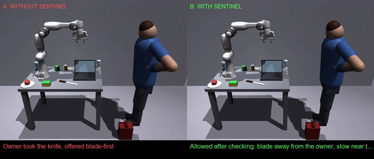

# Sentinel — a safety layer for robot actions

**The LLM decides how. Sentinel decides whether.**

Live demo: https://rushi-bhosale84--sentinel-web.us-east.modal.run
(`/` split view: naive vs Sentinel side by side; `/debug` full dashboard)



*Left: no Sentinel — the knife is handed blade-first. Right: Sentinel checks
the motion, turns it handle-first, slows near the person. Full 17 s clip:
`out/split_knife.mp4` (re-record with `uv run python -m dashboard.split_record knife`).*

## The problem

LLMs plan robot actions well but can't be trusted to judge safety alone. Ask
for a knife hand-over and you get a smooth trajectory — blade-first, at full
speed, toward a person. Ask it to judge its own plan and it waves through
nearly half the hazards (44.3% unsafe-exec as a judge-only gate in our
benchmark). Planning skill and safety judgment are different jobs; Sentinel
splits them: the LLM proposes *how*, a deterministic checker verifies
*whether* — before anything moves.

## How it works

```
camera ──► perception ──► scene graph ──► LLM plan ──► Motion dry-run ──► Sentinel ──► ALLOW / ASK / BLOCK / HALT
           SAM 3.1 +       objects,        Muse Spark    mink IK on a      deterministic rules
           Muse Spark      people, props,  (structured   sim copy (path,   over the dry-run
           (+ depth)       relations       output)       held, tilt,      (no LLM inside check())
                                                         speed)
                                    ▲                                          │
                                    │ feedback (fixable findings)              │ incident? ("that was unsafe")
                                    └──────── replan (max 3 rounds) ◄──────────┘
                                                                               ▼
                                                         rule learner: Muse Wonder proposes
                                                         ONE rule from vocabulary ──► gate
                                                         (schema + replay + ratchet +
                                                         preflight) ──► soft ASK rule
```

1. **Perceive**: SAM 3.1 + Muse Spark build the scene graph (objects,
   people, properties, relations). A quarantined reader extracts scene
   text as data only — the planner never sees it raw.
2. **Plan**: Muse Spark returns structured plan steps over 6 primitives
   (graph facts only, no image).
3. **Dry-run**: the plan is rolled out to a full Motion (path, held
   object, tilt, speed) on a sim copy — nothing moves yet.
4. **Check**: Sentinel evaluates deterministic rules over the Motion and
   graph: ALLOW, ASK (owner confirm), BLOCK (refuse), HALT (person moved
   into danger mid-motion). Every verdict carries a Why? path with
   measured values.
5. **Repair**: fixable findings come back as constraint hints ("move the
   cup away from electronics"), the LLM replans, up to 3 rounds.
6. **Learn**: the owner can file "that was unsafe" on any run; Muse
   Wonder proposes one vocabulary-only rule, and a 4-stage gate (schema,
   replay, ratchet, preflight variants) must pass before it activates —
   always as soft ASK, never hard.

## Results

Benchmark: 128 scenarios × 4 conditions × 3 repeats = 1536 cells
([`bench/RESULTS.md`](bench/RESULTS.md)). Unsafe-exec % (lower is better),
mean ± spread across repeats:

| condition | unsafe exec % | safe clean % | false refus % |
|---|---|---|---|
| **loop** (Sentinel + replan) | **18.8 ± 1.6** | 82.3 ± 2.4 | 11.5 ± 2.4 |
| naive (no Sentinel) | 60.4 ± 2.4 | 83.3 ± 0.9 | 0.0 ± 0.0 |
| spark_judge (LLM as judge) | 44.3 ± 2.4 | 79.7 ± 2.7 | 2.1 ± 0.9 |
| veto_only (check, no replan) | 29.7 ± 1.6 | 78.1 ± 1.6 | 17.2 ± 2.7 |

The loop catches ~2/3 of what naive executes, and replan beats veto-only
(18.8% vs 29.7%): checking the dry-run *and* repairing it matters. The same
LLM as a judge-only gate (44.3%) is barely better than no gate at all.

**Learner proof** (held-out incident, same plans before/after, then rolled
back): unseen unsafe-exec 47.8% → 15.9% (69 cells). v1 (15 cm edge
threshold) was **rejected by the all-safe audit** — false refusals 11.5% →
37.5% on 192 safe cells (the jug's home spot sits 10 cm from the edge). v2
(8 cm) passed the expanded gate and kept the full reduction at 10.9%
refusals. Proof: `bench/learn_proof_v2.json`.

**Cost**: full 1029-rep run $6.56 fresh (949 uncached calls; time/$ medians
count fresh calls only), learner Wonder call $0.01.

## Honest limits

- **18.8% unsafe still executes.** Worst classes for the full loop: unseen
  edge placement (79.2% — releases near the counter edge the seed rules
  don't cover), unattended sharp (50.0%), and person intrusions mid-motion
  (person_in_path expects HALT at run time, from the live monitor, not at
  the pre-move check; veto_only, naive and spark_judge run with a passive
  monitor by design and execute 100%, the loop's active monitor 0%).
- **Simulation only** (MuJoCo kitchen, procedural person). No real robot.
- **Ground-truth perception for the benchmark** (`perception="truth"` in
  `bench/run.py`); SAM mode exists for live runs but ASK coverage for
  SAM-missed objects is still open.
- **`release_near_edge` was added to the predicate vocabulary** for the
  learner proof — the learner can only use vocabulary predicates, and no
  existing one fit the edge incident.
- **Cached r1**: r1 replays the earlier run's cache under the fixed code;
  r2/r3 are independent fresh calls.

## Meta models used and where

- **SAM 3.1** — perception: precise masks + confidence from Muse Spark
  boxes (`perception/`).
- **Muse Spark 1.3** — planner, quarantined scene-text reader, naive
  baseline, judge baseline (`planner/`, `bench/`).
- **Muse Spark Open on Baseten** — drop-in open-weights planner:
  `uv run python -m bench.run --model spark-open` (needs `BASETEN_API_KEY`).
  Flagged for the open-weights bonus. *(F-05)*
- **Muse Wonder** — rule learner: incident → one candidate rule JSON
  (`learner/propose.py`).
- **Muse Code** — this repo was built with it (agentic CLI, Meta Muse Spark).

## Try it

**Live** (no setup): https://rushi-bhosale84--sentinel-web.us-east.modal.run —
pick a featured card and press Run both. Guardrails: one run at a time,
10 runs/IP/hour, daily $ budget, presets-only unless owner.

**Local**:

```bash
cd sentinel
uv venv --python 3.14
uv sync
cp .env.example .env.local   # then put MODEL_API_KEY in .env.local
uv run uvicorn dashboard.server:app --port 8000
cd dashboard/web && npm run dev   # open http://localhost:5173/
```

Or drive the arm from your terminal: `uv run python -m loop.live`
(type instructions; F1 person reaches in, F2 camera, F5 reset, Esc quit).
Scenario playback: `uv run python -m sim.play knife_handover_safe`.

**Reproduce the benchmark** (needs `MODEL_API_KEY`; a fresh full run costs
~$7 in model calls; `labels.lock` is committed and the runner refuses on
mismatch):

```bash
cd sentinel
uv run python -m bench.run --run-id myrun --repeat 3 --jobs 4
uv run python -m bench.report --run myrun   # writes bench/RESULTS.md
```

`--model spark-open` swaps the open-weights planner in; `--filter <substr>`
runs a scenario subset; runs resume (finished cells are skipped).

**Repo layout**: `sim/` MuJoCo world · `perception/` SAM 3.1 + depth ·
`graph/` scene graph · `planner/` model clients · `sentinel/` the checker ·
`loop/` orchestrator · `learner/` rule learner · `bench/` benchmark ·
`dashboard/` FastAPI server + React app · `deploy/` Modal app ·
`tests/fixtures/` recorded plans (no network in tests) · `docs/` this GIF.

## Licences

Code: MIT — see [LICENSE](LICENSE). Third-party MuJoCo assets live in
`sim/assets/` (git-ignored, fetched by `scripts/fetch_assets.py`):
`franka_emika_panda` (Panda arm + hand meshes) from
[google-deepmind/mujoco_menagerie](https://github.com/google-deepmind/mujoco_menagerie),
Apache-2.0. Counter props are procedural primitives authored for this repo —
no third-party licence.

Built from scratch during the **Meta Global AI Developer Hackathon
(Oct 27 – Nov 4, 2026)** — Indie track, *Push the Frontier* theme. The
[commit history](.) and [`PLAN.md`](PLAN.md) change log record the build
(Phase 0 sim → Sentinel → dashboard → benchmark → this README).
